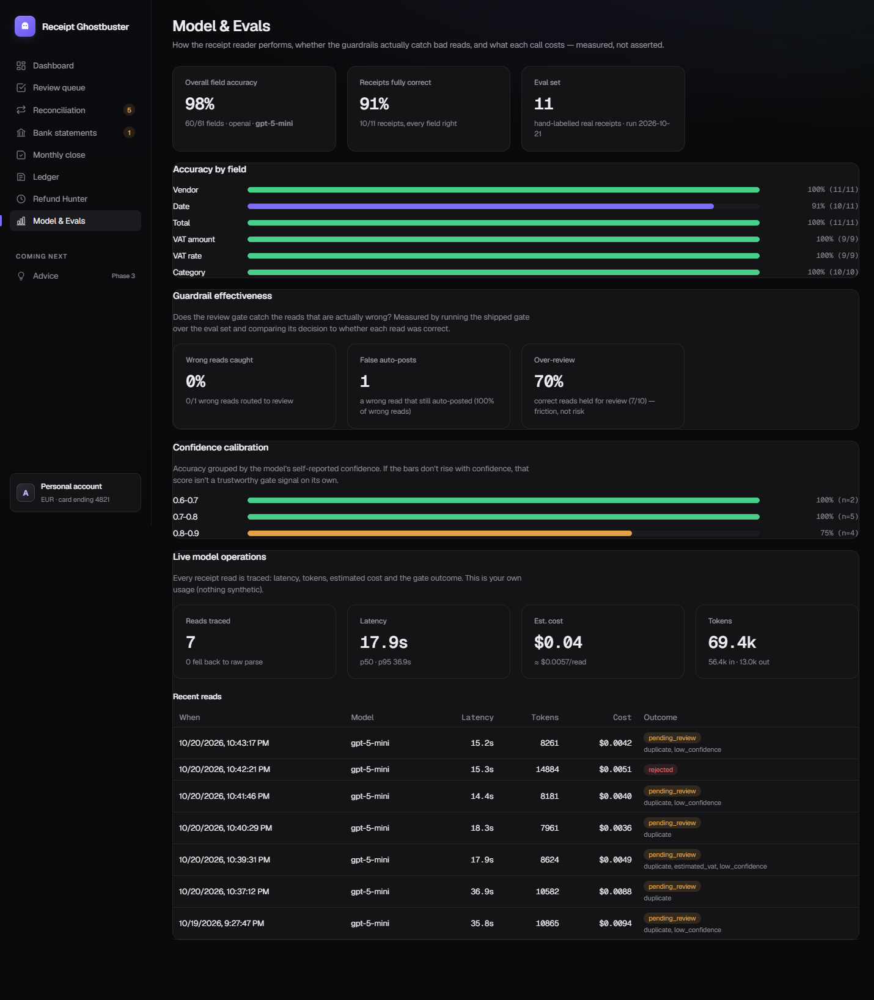

# Receipt Ghostbuster 👻🧾

**A personal money assistant that turns messy expenses into a clean, reconciled, VAT-split ledger — snap a receipt or type a cash expense, and it extracts, categorizes, reconciles against your bank, hunts dead subscriptions, and runs your month-end.**

> *messy expense in → clean, reconciled, categorized record out — with a human confirm gate and the weird stuff flagged.*


*Live demo: runs locally — see [Run it yourself](#run-it-yourself). A hosted demo link is planned.*

---

## The problem

People don't actually know where their money goes: receipts get lost, cash spend is invisible, subscriptions renew silently, and nobody runs a real month-end on their own life. Receipt Ghostbuster automates that whole manual process end-to-end, for a single person managing their own money (VAT included).
→ Full write-up: **[problem-statement.md](problem-statement.md)**.

---

## Features by version

See the full plan and status in **[roadmap.md](roadmap.md)**.

- **v0.1 — Track & Reconcile (MVP) ✅ shipped**
  Receipt snap + cash/manual entry → vision-LLM extraction → confidence gate + deterministic guardrails → rules categorization + VAT (computed in code) → bank CSV import → reconciliation → month-scoped exceptions → monthly close. Screens: Dashboard, Review queue, Reconciliation, Monthly close, Ledger.
- **v0.2 — Refund Hunter ✅ shipped**
  Detects recurring charges, flags unused ones, drafts cancel/refund emails (draft-only), and delivers them as real **Gmail drafts** via n8n. Plus: clickable dashboard drill-downs, per-rate VAT breakdown, duplicate surfacing, and a richer review/edit flow.
- **v0.2.2 — Per-line VAT & testing fixes ✅ shipped**
  **Per-line VAT** (a receipt can hold multiple rates — summed per rate in code, bucket-rounded to match the printed IVA summary), a **multi-rate VAT editor** in the review queue, **duplicate detection at upload**, clickable Ledger rows → full expense detail, editable rows, and clickable status. From the Round 2 testing session (see [feedback-notes.md](feedback-notes.md)).
- **v0.2.3 — Extraction robustness & review UX ✅ shipped**
  From a Round 3 session on hard real receipts (3-rate, discounted, no-VAT, sideways, crumpled): **LLM categorization**, the **printed IVA table as VAT source of truth**, **estimated VAT** when none is printed (clearly flagged), **discount handling**, **server-side auto-rotation** (Pillow), **date year-repair**, a **self-consistency guardrail** + **retake** flow, editable Ledger category, and clickable/deletable reconciliation exceptions. Backend tests **53 → 80** (see [feedback-notes.md](feedback-notes.md), [D14–D21](DECISIONS.md)).
- **v0.2.4 — Bank statements & reconciliation workbench ✅ shipped**
  From a Round 4 session on a real **Revolut** export: **PDF + Revolut-aware CSV import** (auto-detected columns, skips pending/reverted rows), a **Bank statements** section (each file's period + Spent/Received/Net, drill-down), top-ups/transfers excluded from the receipt cycle, and a hand-drivable **reconciliation workbench** — match / unmatch / not-a-match / **No receipt** for online payments / **Match manually**, with believable suggestions only and **View transaction** (the exact CSV row). Plus **replace-a-receipt-photo** (re-scan) and a printed-VAT consistency fix. Backend tests **80 → 97** (see [feedback-notes.md](feedback-notes.md), [D22–D25](DECISIONS.md)).
- **v0.2.5 — Measured accuracy & a reading upgrade ✅ shipped**
  Built a field-level **extraction-accuracy eval harness**, which showed `gpt-4o` mis-reads dense multi-rate VAT tables — so receipt reading moved to the **`gpt-5-mini` reasoning model** (**84% → 93%**). Plus read-every-orientation rotation handling, a retake prompt that trusts reconciliation over self-reported confidence, an Uber-Eats→Dining fix, and a **"No bank line"** action so the reconciliation Unmatched list can reach a clean state. Backend tests **97 → 99** (see [feedback-notes.md](feedback-notes.md), [D26–D28](DECISIONS.md)).
- **v0.2.6 — Robust duplicate detection & a self-contained receipt viewer ✅ shipped**
  From a Round 6 session on two look-alike real receipts: **duplicate detection now matches on vendor + total within a ±30-day window** (brand-prefix vendor match), not on an exact date — so a re-upload is caught even when the model reads the date or vendor slightly differently. Plus a shared receipt lightbox where **Esc / ✕ / backdrop close only the image**, not the dialog behind it. Backend tests **99 → 109** (see [feedback-notes.md](feedback-notes.md), [D29](DECISIONS.md)).
- **v0.3.0 — LLM Observability & Evaluation ✅ shipped**
  Validated structured outputs (**Instructor** + Pydantic, with a safe fallback), per-call **tracing** (latency / tokens / estimated cost / gate outcome) in a new `llm_traces` table, a **measured guardrail** story (the gate is factored into one function the eval also runs — reporting false-auto-post rate, over-review rate and confidence calibration), and an in-app **Model & Evals** dashboard. Optional **LangSmith** tracing + experiments, opt-in. Structured outputs lifted eval accuracy **93% → 98%**. Backend tests **109 → 128** (see [D30](DECISIONS.md)).
- **v0.4 — Advice ⬜ planned**
  Budget-vs-actual variance, rule-based overspend nudges, and an insights feed.

---

## What makes it more than a CRUD app

| Principle | How it shows up | Why |
|---|---|---|
| **The AI is never trusted blindly** | Vision extraction gets a confidence score; a **code-level guardrail** (`validation.py`) runs regardless. Confident + clean → auto-post; anything uncertain → review queue. **All VAT/reconciliation/close math is computed in code.** | [D1](DECISIONS.md#d1--the-ai-is-never-trusted-blindly-design), [D6](DECISIONS.md) |
| **Cash vs bank is first-class** | Cash counts in totals but is *excluded from reconciliation* — so it never shows as a false "unmatched" exception. | [D3](DECISIONS.md) |
| **One ledger is the source of truth** | Every dashboard number drills down to the exact expenses behind it (with receipt view). Nothing double-entered. | [D10](DECISIONS.md) |
| **Nothing financial auto-sends** | Cancellation emails are **draft-only** — n8n creates a Gmail draft, you send it. | [D4](DECISIONS.md) |
| **Fails safe on bad input** | A sideways photo is **auto-rotated** server-side; a crumpled/unreliable read (incl. a VAT table that disagrees with its own item lines) is routed to review with reasons and a **retake** option, not silently mis-posted. | [D9](DECISIONS.md), [D20](DECISIONS.md), [D21](DECISIONS.md) |
| **Reads, never guesses** | The printed IVA summary table is the VAT source of truth; discounts are modelled, not treated as products; VAT it can't read is clearly marked an **estimate** for you to confirm. | [D14](DECISIONS.md), [D17](DECISIONS.md), [D18](DECISIONS.md) |

---

## How it works

```
Browser (React + Vite, :5173)
        │  JSON over HTTP  (talks ONLY to the backend)
        ▼
FastAPI backend (:8000)        ← vision LLM for receipt extraction (server-side key)
  extraction · confidence gate + guardrails · categorization
  VAT math · reconciliation · exceptions · monthly close · subscription detection
        │                                    │
        ▼                                    ▼
Supabase (Postgres + Auth + Storage)   n8n (Docker, :5678) → Gmail draft (draft-only)
```

**Stack & why:**
- **React + Vite** — fast SPA for a dashboard-heavy UI.
- **Python / FastAPI** — all logic as tested endpoints (the accounting-critical paths are unit-tested).
- **Supabase (Postgres + Auth + Storage)** — managed DB, row-level security, and receipt image storage without standing up infra.
- **Vision LLM (OpenAI gpt-4o / Anthropic)** — reads receipts; provider is swappable.
- **n8n** — thin orchestration for Gmail delivery + cron, so email logic stays out of the app ([D5](DECISIONS.md)).
- **Bank via CSV import** — works with any bank, no open-banking OAuth ([D2](DECISIONS.md)).

---

## Results

- **Extraction accuracy (measured):** a reproducible harness ([`backend/scripts/eval_extraction.py`](backend/scripts/eval_extraction.py)) scores the shipped pipeline — the vision read **plus** the deterministic VAT/amount/category logic — field-by-field against a hand-labelled set of 20 real Portuguese receipts (multi-rate VAT tables, rotated photos, discounts, a crumpled receipt, a 0%-VAT tobacco receipt, and a payment-only receipt). On `gpt-5-mini`:

  | vendor | date | total | vat amount | vat rate | category | **overall** |
  |---:|---:|---:|---:|---:|---:|---:|
  | 100% | 95% | 100% | 100% | 100% | 100% | **99.1%** |

  Choosing the model was itself eval-driven: `gpt-4o` scored **84%** and reliably mis-read dense 3-rate VAT tables; swapping in the `gpt-5-mini` reasoning model (which reads those tables correctly) lifted it to **93%**, and validated structured outputs (Instructor, v0.3.0) took it to **98%** — and on the grown 20-receipt set it holds at **99.1%**, the one miss a date read a day off. (The eval also caught a *labelling* error of its own — a tobacco receipt labelled 0%/Tobacco from outside knowledge the receipt doesn't print; corrected, because an extraction label must score only what's on the paper.) See [`backend/eval/RESULTS.md`](backend/eval/RESULTS.md).
- **Model comparison (accuracy × latency × cost):** a reproducible runner ([`backend/scripts/eval_models.py`](backend/scripts/eval_models.py)) scores several models over the same set on every axis a production choice turns on, and breaks accuracy down **by receipt type** so a strong average can't hide a weak slice. Run over 20 receipts — **gpt-5-mini 98.2%** · **gpt-4o 94.5%** · **claude-haiku-4-5 87.3%** (the spread is mostly VAT; gpt-5-mini is the slowest but the cheapest per read *and* the most accurate). The by-type view surfaced **rotation** as the weak slice where the cheap model collapses (gpt-5-mini 94.7%, Haiku 57.9%). See [`backend/eval/MODELS.md`](backend/eval/MODELS.md). *(n=20, so small differences aren't significant. A Claude Opus 4.8 column is pending its credits.)*
- **Guardrails, measured (not asserted):** the same harness runs the shipped review gate over the set and reports whether it actually catches bad reads — the **false-auto-post rate**, the **over-review rate**, and a **confidence-calibration** table — surfaced in an in-app **Model & Evals** dashboard alongside live per-read latency/cost. An honest finding it produced: the model's self-reported confidence is poorly calibrated (0.7–0.8 reads were 100% correct, 0.8–0.9 only 75%), so the gate currently over-reviews correct reads. See [D30](DECISIONS.md).


*The in-app **Model & Evals** page: field accuracy, guardrail effectiveness, confidence calibration, and live per-read latency/cost/outcome — the layers a production LLM feature has and a demo usually skips.*
- **Reconciliation / close:** figures reconcile to the cent against the ledger (covered by pytest). Bank import handles a real Revolut CSV and text-based PDF statements; reconciliation can be driven by hand (match / unmatch / not-a-match / no-receipt) with believable suggestions only.
- **Tests:** 128 passing (reconciliation + manual-match + no-bank-match helpers, VAT incl. per-line/mixed-rate + bucket rounding + printed-table source of truth, categorization incl. food-delivery rules, date re-read + year-repair, discounts, estimated/0% VAT, duplicate fingerprinting, the gate decision + guardrail/calibration metrics, LLM-trace cost/usage helpers, close, exceptions, validation, subscriptions, CSV/PDF bank import, statement aggregation).
- **Impact:** turns a manual personal month-end into minutes; surfaces forgotten subscriptions by annual cost.

---

## Process (how this was built)

This project is built the way a product engineer works — ship small, test, capture feedback, decide, iterate:

- **[roadmap.md](roadmap.md)** — phases, goals, and what's planned.
- **[DECISIONS.md](DECISIONS.md)** — every real decision as Problem → Evidence → Decision → Result.
- **[feedback-notes.md](feedback-notes.md)** — real testing rounds; the evidence behind the decisions.
- **[CHANGELOG.md](CHANGELOG.md)** — what changed per version.

---

## Run it yourself

### Prerequisites
- **Python 3.14** and **Node 18+**
- A **Supabase** project and a **vision-LLM API key** (OpenAI or Anthropic)
- Copy `backend/.env.example` → `backend/.env` and fill it in. Set `DEV_USER_ID` to a user UUID for keyless demo mode. Copy `frontend/.env.example` → `frontend/.env` (defaults to `VITE_API_BASE_URL=http://localhost:8000`).

```powershell
# backend
cd backend
py -3.14 -m venv .venv
.\.venv\Scripts\python.exe -m pip install -r requirements.txt
.\.venv\Scripts\python.exe scripts\apply_schema.py
.\.venv\Scripts\python.exe scripts\load_sample_data.py   # expenses + bank CSV + reconcile

# frontend
cd ..\frontend
npm install
```

### Start it
```powershell
# Terminal 1 — backend (API on :8000). On Windows run ONE process, no --reload.
cd backend
.\.venv\Scripts\python.exe -m uvicorn app.main:app --port 8000

# Terminal 2 — frontend (UI on :5173)
cd frontend
npm run dev
```
Open **http://localhost:5173**. API docs at **http://localhost:8000/docs**.
Refund Hunter's Gmail delivery (Phase 2) needs n8n — see **[n8n/README.md](n8n/README.md)**.

### Tests
```powershell
cd backend
.\.venv\Scripts\python.exe -m pytest -q
```

---

## Demo script (≈3 minutes)

The sample dataset is shaped so **every reconciliation path shows up**:

1. **Dashboard** — opens on the latest month with data. Click any number (Total spent, VAT, Card/cash, Reconciled, a category) to drill into the exact expenses behind it. *"Every number is computed in code and traces back to the ledger."*
2. **Add → Snap a receipt** — a confident read auto-posts; a shaky/rotated one lands in the **Review queue** with reasons. *"The AI is never trusted blindly."*
3. **Add → Manual / cash** — add cash; it counts in totals but is **never** a reconciliation exception.
4. **Reconciliation** — **Run reconciliation**, then walk the exceptions (amount-differs, duplicate, no-bank-match). Hit **Resolve** on the duplicate → the Ledger filters to the flagged pair, badged side by side.
5. **Monthly close** — money in/out, VAT owed, and a close gated while card items are unreconciled.
6. **Refund Hunter** — detected subscriptions by annual cost; draft a cancellation email → **Save to Gmail drafts** (draft-only).

---

## Out of scope

Multi-currency / FX · full double-entry bookkeeping · tax-return generation · multi-user / client accounts · live open-banking API.

## Future work

A hosted live demo · a mobile app · support for more banks (more CSV formats / open-banking) · more languages/locales for receipts and VAT rules. (**Per-line VAT** — multiple rates per receipt — is now built; see [D12](DECISIONS.md).) See [roadmap.md](roadmap.md).
