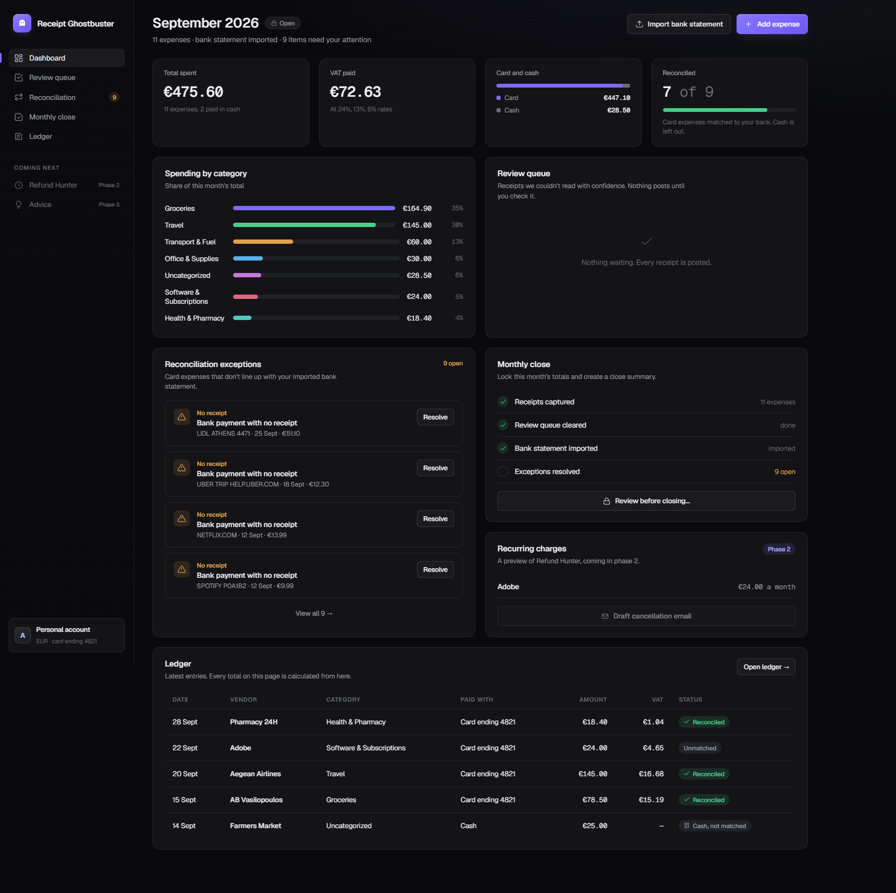
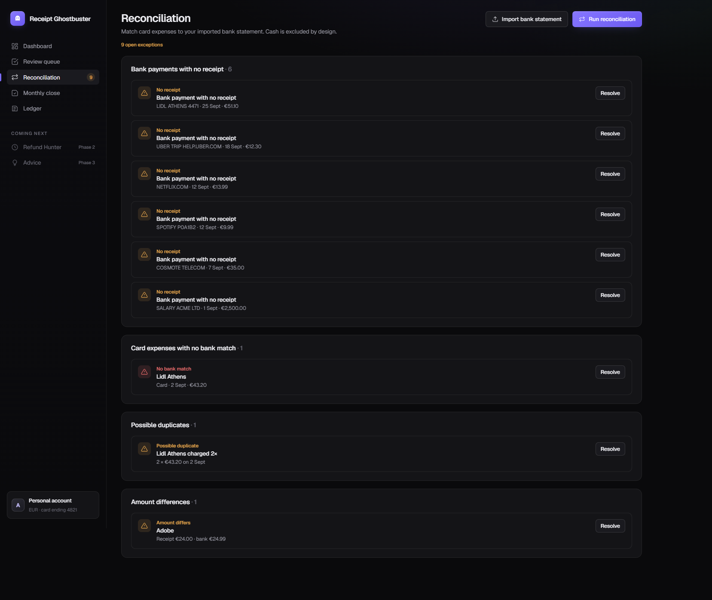

# Receipt Ghostbuster 👻🧾

**A personal money assistant that turns messy expenses into a clean, reconciled, VAT-split ledger — with a human confirm gate and the weird stuff flagged.**

> One line: *messy expense in → clean, reconciled, categorized record out.*

Snap a receipt or type a cash expense → a vision model extracts vendor/amount/date/VAT → it's auto-categorized → a **confidence gate** sends anything uncertain to a review queue (nothing financial is trusted blindly to the AI) → card spend is **reconciled against your bank statement** → anomalies surface as **exceptions** (unmatched, duplicate, amount-mismatch, missing VAT) → a **monthly close** locks the numbers.



---

## Why this project exists

A portfolio piece built to demonstrate three things concretely:

1. **I can ship** — a complete, working, demoable product, not a prototype.
2. **I can automate a messy manual process end-to-end** — receipt → extraction → categorization → reconciliation → close, with the human kept in the loop where it matters.
3. **I have real accounting depth** — VAT breakdowns, cash-vs-bank source logic, a reconciliation exceptions report, and an automated month-end.

It's shipped in deliberate phases. **Phase 1 (Track & Reconcile) is complete and is what you demo below.** Phases 2 (Refund Hunter) and 3 (Advice) are scoped but intentionally not built yet — shipping a polished small thing beats a half-built big thing.

---

## What makes it more than a CRUD app

| Principle | How it shows up |
|---|---|
| **The AI is never trusted blindly** | Vision extraction gets a confidence score. Above the threshold auto-posts; below it goes to a review queue. **All VAT / reconciliation / close math is computed in code, never by the model.** |
| **Cash vs bank is a first-class distinction** | Cash expenses count in totals and categories but are *excluded from reconciliation* — there's nothing in the bank to match them to, so they never show up as false "unmatched" exceptions. |
| **One ledger is the source of truth** | Every number on the dashboard, the reconciliation view and the monthly close is derived from the same ledger. Nothing is double-entered. |
| **Secrets stay server-side** | The browser never holds an API key. It talks only to the FastAPI backend; Supabase service-role and the LLM key live on the server. |
| **Nothing financial auto-sends** | Human confirm gate everywhere. (Phase 2's cancellation emails will be draft-only.) |

---

## Architecture

```
Browser (React + Vite, :5173)
        │  JSON over HTTP  (talks ONLY to the backend)
        ▼
FastAPI backend (:8000)        ← vision LLM for receipt extraction (server-side key)
  extraction · confidence gate · rules-based categorization
  VAT math · reconciliation engine · exceptions · monthly close
        │
        ▼
Supabase (Postgres + Auth + Storage)   ← ledger, bank transactions, receipt images
```

**Stack:** React 18 + Vite · TanStack Query · React Router · Geist type · Python / FastAPI · Supabase (Postgres + auth + storage) · vision LLM (Anthropic or OpenAI) · bank data via **CSV import** (no open-banking API).

**Repo layout:**
```
RECEIPT-GHOSTBUSTER/
├── backend/        FastAPI app, reconciliation/close/VAT logic, tests, scripts
├── frontend/       React + Vite UI (this is the part you open in a browser)
├── db/             schema.sql
├── sample-data/    September-2026 demo dataset (bank CSV + expenses JSON)
└── docs/           screenshots
```

---

## The 5 screens

| Screen | What it does |
|---|---|
| **Dashboard** | Month at a glance: total spent, VAT paid, card-vs-cash split, reconciled ratio, spending by category, plus live previews of the review queue, exceptions, monthly close and the ledger. |
| **Review queue** | Low-confidence receipts with a confidence meter. Post (confirm) or discard — nothing posts to the ledger until you say so. |
| **Reconciliation** | Exceptions grouped by type (no receipt, no bank match, duplicate, amount differs, missing VAT) with a one-click **Run reconciliation**. |
| **Monthly close** | Money in/out/net, VAT, bank cash-flow, and a gate that won't let you close while card expenses are still unreconciled. |
| **Ledger** | The single source of truth. Filter by source / status / category; every total is calculated from here. |



---

## Run the demo

### Prerequisites (one time)
- **Python 3.14** and **Node 18+**
- A **Supabase** project and a **vision-LLM API key** (Anthropic or OpenAI)
- Copy `backend/.env.example` → `backend/.env` and fill in the values. Set `DEV_USER_ID` to a user UUID to run in keyless demo mode.
  Copy `frontend/.env.example` → `frontend/.env` (defaults to `VITE_API_BASE_URL=http://localhost:8000`).

```powershell
# backend deps
cd backend
py -3.14 -m venv .venv
.\.venv\Scripts\python.exe -m pip install -r requirements.txt

# apply the database schema + load the demo dataset
.\.venv\Scripts\python.exe scripts\apply_schema.py
.\.venv\Scripts\python.exe scripts\load_sample_data.py   # posts expenses, imports the bank CSV, runs reconciliation

# frontend deps
cd ..\frontend
npm install
```

### Start it (two terminals)

**Terminal 1 — backend (API on :8000)**
```powershell
cd backend
.\.venv\Scripts\python.exe -m uvicorn app.main:app --reload
```

**Terminal 2 — frontend (UI on :5173)**
```powershell
cd frontend
npm run dev
```

Open **http://localhost:5173**. API docs are at **http://localhost:8000/docs**.

---

## Demo script (≈3 minutes)

The sample dataset is shaped so **every reconciliation path shows up**. Walk it like this:

1. **Dashboard** — it opens on **September 2026**. Point out the four stat cards: total spent, VAT paid (split across 24 / 13 / 6% rates), card-vs-cash, and the reconciled ratio. *"Every one of these is computed in code from the ledger — the AI only reads receipts."*
2. **Add an expense → Snap a receipt** — upload a receipt photo. The vision model extracts it; a confident read posts straight to the ledger, a shaky one lands in the **Review queue**. *"The AI is never trusted blindly."*
3. **Add an expense → Manual / cash** — add a cash expense. Note it on the dashboard: it counts in totals and categories, but on the Reconciliation screen it's **never** flagged as unmatched — *by design, there's nothing in the bank to match cash to.*
4. **Reconciliation** — hit **Run reconciliation**, then walk the exceptions: Adobe (receipt €24.00 vs bank €24.99 = **amount differs**), Lidl **charged twice** (duplicate), Netflix / Spotify / Cosmote with **no receipt** (these become Phase 2 subscription candidates), and the salary line as income.
5. **Monthly close** — show money in vs out, VAT owed, bank cash-flow, and that the close is **gated** while card expenses are still unreconciled. *"That's a real month-end, not a total."*
6. **Ledger** — filter by Cash, then Reconciled. *"One ledger. Every number on every screen comes from here."*

---

## What's intentionally out of scope (Phase 1)

Multi-currency / FX · full double-entry bookkeeping · tax-return generation · multi-user / client accounts · live open-banking API. **Phase 2** adds Refund Hunter (recurring-charge detection + draft cancellation emails, never auto-sent). **Phase 3** adds Advice (overspend nudges, budget-vs-actual variance).

---

## Testing

```powershell
cd backend
.\.venv\Scripts\python.exe -m pytest -q
```

The backend ships with a passing test suite covering extraction gating, VAT math, the reconciliation engine, cash exclusion, exceptions and the monthly close.
