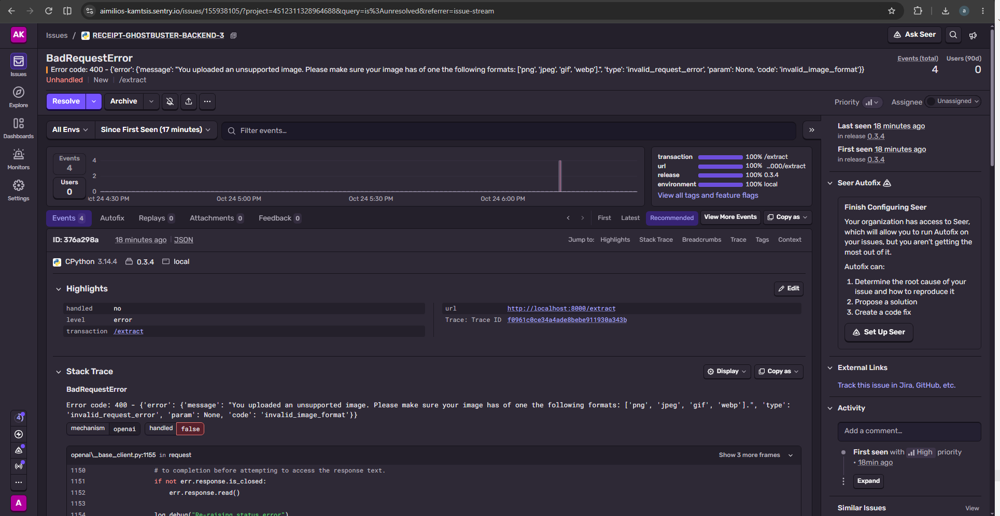
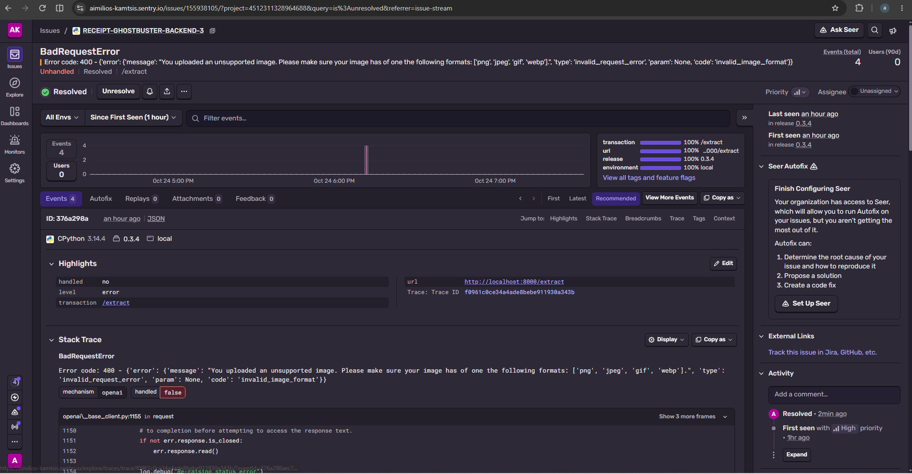

# Monitoring & error tracking

Receipt Ghostbuster has three complementary observability layers. This document covers
the third; it is **opt-in** and **off by default**.

| Layer | What it answers | Where |
|---|---|---|
| **LLM observability** (LangSmith, optional) | How did a specific *read* behave? (prompt, latency, tokens, cost, gate) | LangSmith dashboard + `llm_traces` table |
| **Accuracy evaluation** (the harness) | How *accurate* is extraction, field by field, and does the gate catch bad reads? | `backend/eval/RESULTS.md`, the `/model-evals` page |
| **App-layer error tracking** (Sentry, optional) | What *failed* — exceptions, swallowed errors, unhandled 500s? | Sentry dashboard |

Sentry is the application-layer complement: it captures the failures the first two
layers don't — a provider call that throws, a Supabase/n8n call that fails, a PDF/CSV
parser that blows up, or an unhandled 500.

## What it is and isn't

- **Opt-in.** Nothing is sent unless `SENTRY_DSN` (backend) / `VITE_SENTRY_DSN`
  (frontend) is set. With no DSN the app runs exactly as before — Sentry is a no-op.
- **Errors only.** Performance tracing is off (`traces_sample_rate = 0.0`), which keeps
  usage inside Sentry's free **Developer** tier (5k errors/month).
- **Free.** The integration and the Sentry MCP (below) cost nothing. Seer (Sentry's
  paid AI auto-fix agent) is **not** required — see the AI-debug loop section.

## Privacy — what is *not* sent

Receipts and bank statements are personal financial data, so error tracking is wired to
never ship it (consistent with [PRIVACY.md](PRIVACY.md) and the on-device model option):

- Initialised with **`send_default_pii=False`**.
- A **`before_send` scrubber** (`backend/app/services/monitoring.py`) strips the request
  **body, headers, cookies and query string** from every event — so a receipt image,
  bank-statement text, an IBAN/card number, or an auth token is never attached to an
  issue. Only the exception, stack trace, and our own safe tags (e.g. `surface`) are sent.
- This guarantee is unit-tested (`backend/tests/test_monitoring.py`).

## Enabling it

Backend — add to `backend/.env` (git-ignored):

```
SENTRY_DSN=<your FastAPI project DSN>
SENTRY_ENVIRONMENT=local
SENTRY_TRACES_SAMPLE_RATE=0.0
```

Frontend — add to `frontend/.env` (git-ignored):

```
VITE_SENTRY_DSN=<your React project DSN>
VITE_SENTRY_ENVIRONMENT=local
```

Restart the backend (one uvicorn, no `--reload`) and rebuild/reload the frontend.
`GET /health` reports `"sentry_enabled": true` when the backend DSN is picked up.

## What gets captured

- **Unhandled 500s** — automatically, via the Sentry FastAPI/ASGI integration.
- **Swallowed exceptions** made explicit with `monitoring.capture(exc, surface=...)`, tagged
  by `surface` so they're filterable:
  - `extraction.instructor_fallback` — structured output fell back to raw parse
  - `extraction.date_reread`, `extraction.orientation_read`
  - `extract.record_trace`, `extract.upload_receipt`
  - `pdf_import.llm_structuring`
  - `bank.insert_statement`, `bank.insert_transactions`
  - `refunds.n8n_webhook`
- **Frontend render errors** — caught by `Sentry.ErrorBoundary`, which shows a small
  reload fallback instead of a blank page.

## The AI-debug loop (free)

The differentiator isn't just collecting errors — it's closing the loop with an agent:

1. **Sentry MCP → Claude Code (free, open-source).** Connect the Sentry MCP server to
   Claude Code; the agent can then list issues, read a real captured stack trace, and
   propose a fix against the code. This is the primary, zero-cost workflow.
2. **Seer (optional, paid).** Sentry's own AI debugger can suggest a root cause/fix from
   an issue page. It's a paid add-on with a 14-day trial — useful for a one-off
   demonstration, but **not** a dependency of this project.

> Note on scope: this is a locally-run, single-user app, so Sentry is wired **for
> production and exercised during local testing** — not a claim of a live multi-user
> deployment. The value is the instrumentation and the triage loop being real.

## Worked example: a real error, caught and fixed

The first error Sentry caught in local testing was a genuine bug. Uploading a file that
**isn't a real image** — a text file renamed `.jpg`, or a corrupt/truncated photo — made
the vision call raise `openai.BadRequestError (invalid_image_format)`, which propagated as
an **unhandled 500** out of `/extract`. Because an unhandled 500 skips the CORS middleware,
the browser couldn't read the response and showed the misleading *"Can't reach the
backend"* — and the pipeline had burned several vision calls on the garbage first.



Note the captured event: `Unhandled`, transaction `/extract`, release `0.3.4` — and the
request is **scrubbed**. Only the bare endpoint (`/extract`) is shown; the uploaded file
body, headers and cookies were stripped by `before_send`, so nothing sensitive reached
Sentry.

**The fix (`e05003a`):** `extraction.is_readable_image()` checks the upload actually decodes
as PNG/JPEG/GIF/WebP *before* any model call. A non-image now returns the same graceful
"couldn't read this — use a clear photo" response as an unreadable receipt (no 500, no
wasted API calls), and `/rescan` rejects it with a clear `400`. Covered by
`backend/tests/test_image_guard.py`.

Re-uploading the same file afterwards shows the clean in-app message and produces **no new
Sentry error**. The issue was then marked **Resolved** — the closing bookend:



That's the complete loop: *observed → caught (scrubbed) → root-caused → fixed + tested →
verified live → resolved.*

> The user-facing "after" (the app's graceful *"not a readable image"* message) isn't shown
> here: that screenshot was taken over a live dashboard with real vendor names and amounts, so
> it's kept local until cropped — the same "review every screenshot for leaked data" rule this
> whole setup is built around.
